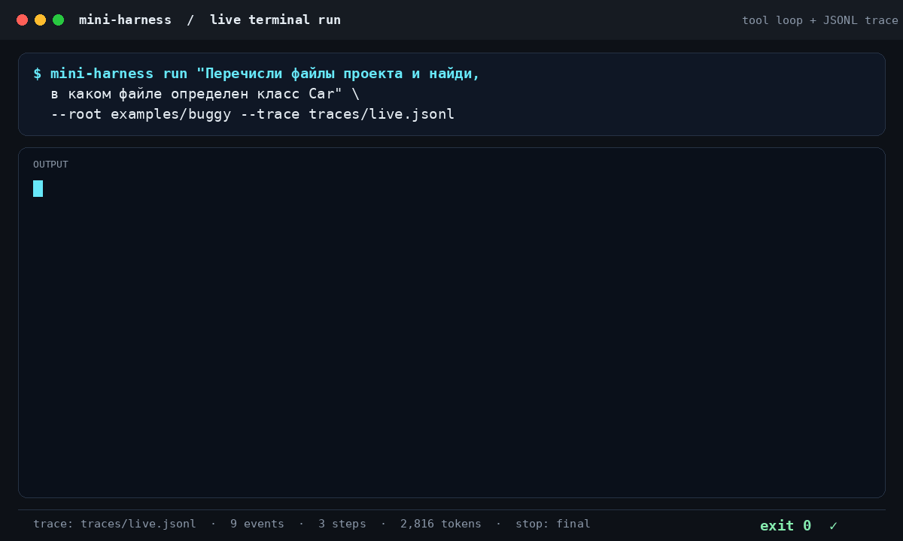

# mini-harness

[](https://github.com/MrGrose/mini-harness/actions/workflows/ci.yml)

A small, readable agent harness: the loop, tool registry, path policy, JSONL
trace and tests that turn a chat model into a coding agent.



This is a learning and portfolio project, not a production framework.

## What it does

```bash
mini-harness run "найди, где определяется класс Car" --root ./examples/buggy
```

The agent can list directories, search with a regular expression, read text
files, write a file after confirmation, run pytest and run ruff. Every step is
written to a trace when `--trace` is passed:

```bash
mini-harness run "почему падает тест discount" \
  --root ./examples/buggy \
  --trace traces/run.jsonl

mini-harness run "исправь скидку и прогони тесты" \
  --root ./examples/buggy \
  --yes \
  --trace traces/fix.jsonl
```

## Install

```bash
python -m venv .venv
. .venv/bin/activate
pip install -e ".[dev]"
cp .env.example .env
```

Set `MINI_HARNESS_API_KEY` and optionally `MINI_HARNESS_BASE_URL` and
`MINI_HARNESS_MODEL`. Any OpenAI-compatible endpoint works.

## Architecture

```
task -> CLI -> AgentLoop -> model -> tool calls
                       |
                       v
                 ToolRegistry -> ProjectPolicy
                       |
                       v
             read_file / list_dir / grep
```

The loop stops when the model returns a message without tool calls or when it
reaches `--max-steps`. Tool errors are returned to the model as text instead of
crashing the run.

## Safety

- All paths are resolved and must stay inside `--root`.
- `.env`, `.git`, private keys and files above 200 KB are refused.
- Tool output is truncated before it goes back into the context.
- API keys are read from the environment and never written to the trace.

## Evaluation

`evals/tasks.json` contains 20 tasks over `evals/project`: 12 simple questions,
5 composite questions and 3 attempts to read a sensitive file or escape the
project root. Run them against a real model:

```bash
python evals/run_eval.py --max-steps 6
```

The runner copies the fixture for every task, writes a trace per task, checks
the answer and writes `reports/eval-YYYY-MM-DD.md`.

The latest run in this repository is in `reports/`. A task counts as solved
when every expected term appears in the answer, or when a refusal task records
a policy denial.

## Tests

```bash
pytest -q
ruff check src tests evals
```

The tests use a scripted fake model and do not call the network.

## Status

Stages 1-4 are implemented: read and write tools, confirmation gate, test and
lint commands, context compaction, evaluation, tests and CI. The project is
published at https://github.com/MrGrose/mini-harness. See the spec at
`~/Hermes/notes/spec-mini-harness.md`.

## License

MIT.
